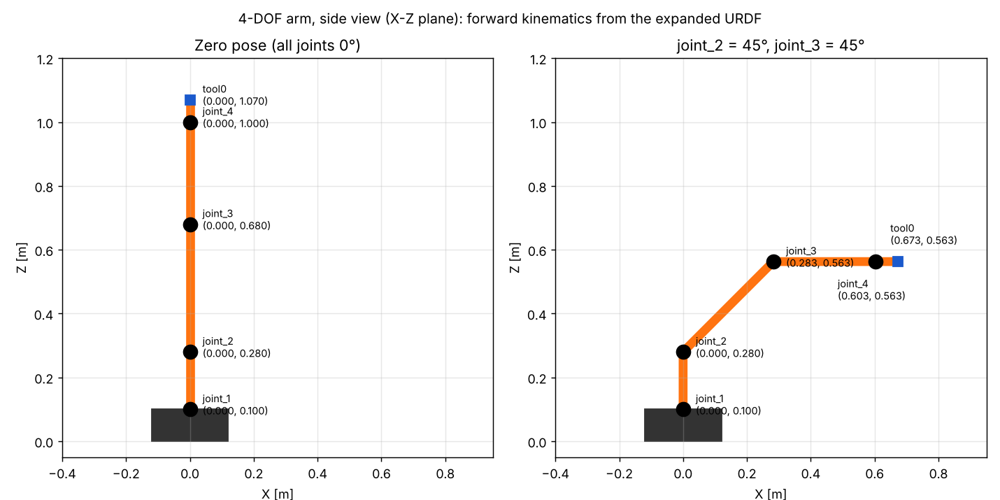
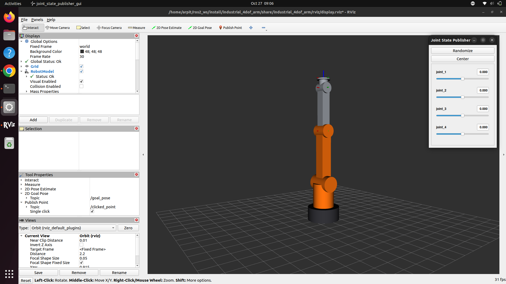
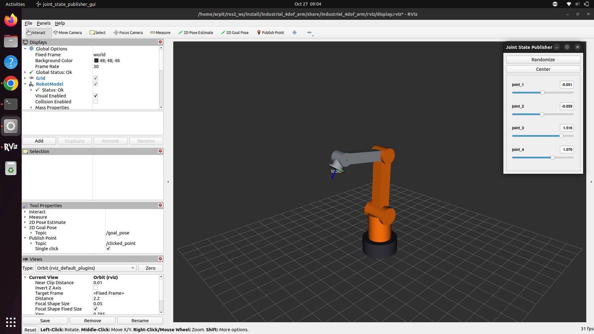
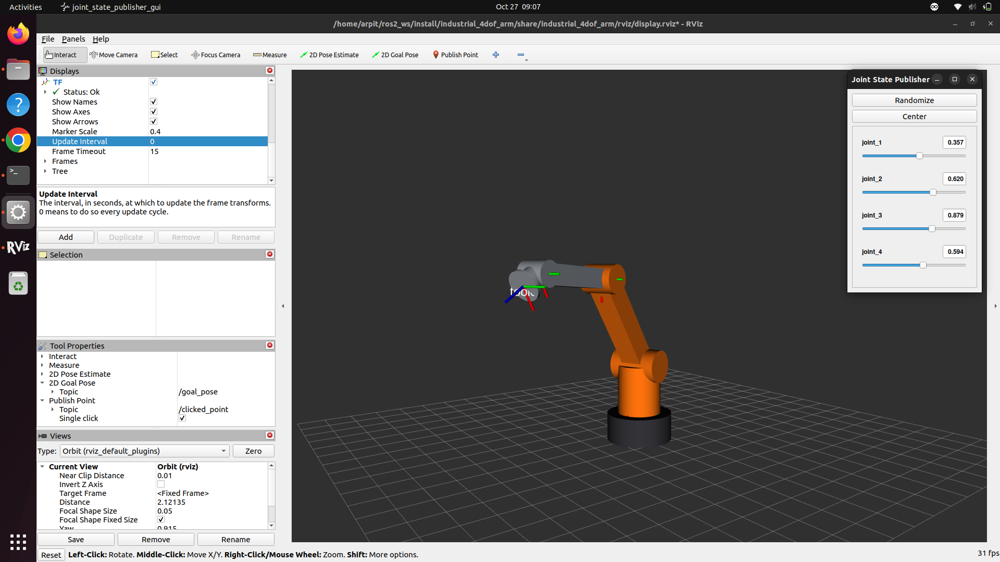
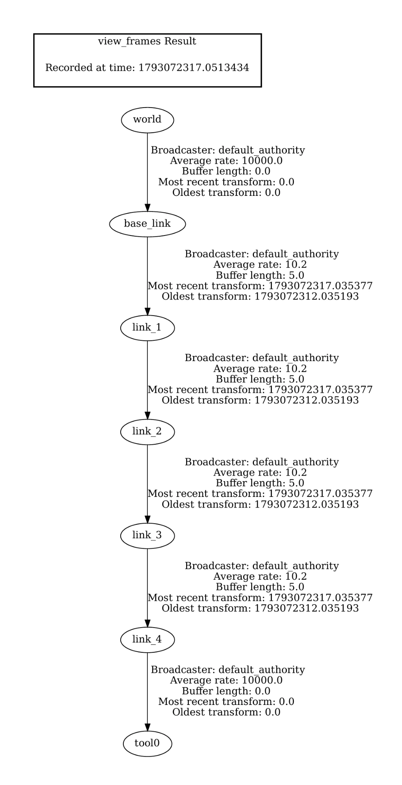

# URDF Modeling of a 4-DOF Industrial Robotic Arm in ROS 2

| | |
|---|---|
| **Package** | `industrial_4dof_arm` |
| **ROS 2 distribution** | Humble Hawksbill (Ubuntu 22.04) / Iron Irwini |
| **Tools** | URDF, Xacro, robot_state_publisher, joint_state_publisher_gui, RViz2, tf2_tools |
| **Author** | Arpit Awasthi |
| **Submission folder** | `ROS2_URDF_4DOF_Arm_<StudentName>` |

---

## Table of Contents

1. [Abstract](#1-abstract)
2. [Problem Statement and Objectives](#2-problem-statement-and-objectives)
3. [Tools and Software Environment](#3-tools-and-software-environment)
4. [Package Architecture](#4-package-architecture)
5. [Q1: Robot Structure Design](#5-q1-robot-structure-design)
6. [Q2: URDF Link Definition](#6-q2-urdf-link-definition)
7. [Q3: Joint Definition](#7-q3-joint-definition)
8. [Q4: Assembly Validation](#8-q4-assembly-validation)
9. [Q5: RViz Visualization](#9-q5-rviz-visualization)
10. [Q6: TF Tree Verification](#10-q6-tf-tree-verification)
11. [Build, Source and Run: Command Reference](#11-build-source-and-run-command-reference)
12. [Results](#12-results)
13. [Troubleshooting](#13-troubleshooting)
14. [Conclusion and Future Work](#14-conclusion-and-future-work)
15. [References](#15-references)

---

## 1. Abstract

This project models a four-degree-of-freedom (4-DOF) articulated industrial arm in the
Unified Robot Description Format (URDF) for ROS 2. The model is written in modular Xacro: one
file each for materials, inertia macros and the robot. It defines a fixed base, four revolute
joints (waist, shoulder, elbow and wrist), and a tool-centre-point frame for mounting a gripper.
Every physical link has visual, collision and inertial elements. Every joint has position,
effort and velocity limits plus dynamics (damping and friction) parameters. A Python launch
file expands the Xacro at run time and starts `robot_state_publisher`,
`joint_state_publisher_gui` and RViz2 with a saved configuration that shows the Grid,
RobotModel and TF displays. The model is checked in three ways: automated structural tests,
`check_urdf`, and inspection of the TF tree with `tf2_tools`.

## 2. Problem Statement and Objectives

Design and implement a ROS 2 URDF model of a 4-DOF industrial robotic arm that:

- defines all links and joints correctly,
- includes visual and collision elements,
- uses proper joint types and limits,
- loads successfully in RViz, and
- displays a correct TF tree.

**Required kinematic structure**

| # | Element | Type / Axis | Range |
|---|---------|-------------|-------|
| 0 | Base Link | Fixed to the world (ground) | – |
| 1 | Joint 1, waist rotation | Revolute about Z | −180° to +180° |
| 1 | Link 1, shoulder link | – | – |
| 2 | Joint 2, shoulder pitch | Revolute about Y | −90° to +90° |
| 2 | Link 2, upper arm | – | – |
| 3 | Joint 3, elbow pitch | Revolute about Y | −135° to +135° |
| 3 | Link 3, forearm | – | – |
| 4 | Joint 4, wrist pitch / roll | Revolute about Y (default) or X | −180° to +180° |
| 4 | Link 4, end-effector / gripper mounting base | – | – |

## 3. Tools and Software Environment

| Tool | Purpose |
|------|---------|
| ROS 2 Humble / Iron | Middleware, build system, launch system |
| Xacro | XML macro language that generates the URDF (properties, math, macros, includes) |
| URDF | Robot description: links, joints, geometry, inertia, limits |
| `robot_state_publisher` | Publishes `/robot_description` and computes TF from `/joint_states` |
| `joint_state_publisher_gui` | Slider GUI that publishes `/joint_states` for every movable joint |
| RViz2 | 3D visualization of the robot model and TF frames |
| `tf2_tools` / `rqt_tf_tree` | Visualize and verify the TF tree |
| `liburdfdom-tools` | `check_urdf` and `urdf_to_graphviz` for offline validation |
| colcon / ament_cmake | Build and test the package |

**Install the dependencies (Humble shown; replace `humble` with `iron` for Iron):**

```bash
sudo apt update
sudo apt install -y \
  ros-humble-xacro \
  ros-humble-robot-state-publisher \
  ros-humble-joint-state-publisher \
  ros-humble-joint-state-publisher-gui \
  ros-humble-rviz2 \
  ros-humble-tf2-tools \
  ros-humble-tf2-ros \
  ros-humble-rqt-tf-tree \
  liburdfdom-tools \
  python3-colcon-common-extensions
```

## 4. Package Architecture

```
industrial_4dof_arm/
├── CMakeLists.txt                 # ament_cmake build; installs urdf/ launch/ rviz/
├── package.xml                    # Package manifest (format 3) and dependencies
├── README.md                      # This report and user guide
├── docs/
│   ├── Project_Report.pdf         # PDF rendering of this report
│   └── images/
│       └── kinematic_schematic.png
├── launch/
│   └── display.launch.py          # robot_state_publisher + joint_state_publisher_gui + RViz2
├── rviz/
│   └── display.rviz               # RViz2 config: Grid, RobotModel, TF
├── test/
│   └── test_urdf_model.py         # pytest: links, joints, axes, limits, inertia, tree shape
└── urdf/
    ├── industrial_arm.urdf.xacro  # Top-level robot description
    ├── inertials.xacro            # Inertia macros: box, cylinder, sphere
    └── materials.xacro            # Colour definitions
```

**Design decisions**

- **Modular Xacro.** Materials and inertia formulas sit in their own files and are pulled in
  with `<xacro:include>` using relative paths, so the model expands the same way from the
  source tree and from the installed `share/` directory.
- **Parameterised geometry.** Every dimension, mass and joint limit is a `<xacro:property>` at
  the top of `industrial_arm.urdf.xacro`. One change updates the visual, collision and
  inertial elements and the joint origins together.
- **Computed inertia.** The `box_inertial` and `cylinder_inertial` macros calculate the inertia
  tensor from mass and dimensions, so the values always match the geometry.
- **`world` anchor.** A fixed `world_to_base` joint attaches `base_link` to the ground.
  This is the "fixed to world" requirement, and it makes `world` the RViz fixed frame.
- **`tool0` frame.** A fixed frame at the face of the tool flange marks where a gripper
  attaches and gives a reference point for the end-effector pose.
- **Configurable wrist.** The `wrist_axis` Xacro argument selects pitch about Y (default)
  or roll about X for Joint 4. Both options are allowed by the specification.

## 5. Q1: Robot Structure Design

The arm is a serial open chain in the classic articulated (anthropomorphic) layout:
a waist that turns the whole arm, two parallel pitch joints (shoulder and elbow) that
position the wrist in the vertical plane, and a wrist joint that orients the tool.

```
                         tool0 (TCP)       z = 1.070 m
                           │  fixed
                        [link_4]  end-effector / gripper mount
                           │
                     ◉  joint_4  wrist pitch (Y)  ±180°     z = 1.000 m
                           │
                        [link_3]  forearm  (0.32 m)
                           │
                     ◉  joint_3  elbow pitch (Y)  ±135°     z = 0.680 m
                           │
                        [link_2]  upper arm  (0.40 m)
                           │
                     ◉  joint_2  shoulder pitch (Y)  ±90°   z = 0.280 m
                           │
                        [link_1]  shoulder turret  (0.18 m)
                           │
                     ◉  joint_1  waist yaw (Z)  ±180°       z = 0.100 m
                           │
                      [base_link]  pedestal  (0.10 m)
                           │  fixed
                        world  (ground)                     z = 0.000 m
```

**Labelled kinematic chain**

| Order | Parent link | Joint | Type | Axis (parent frame) | Child link | Role |
|-------|-------------|-------|------|---------------------|------------|------|
| 0 | `world` | `world_to_base` | fixed | – | `base_link` | Bolts the pedestal to the ground |
| 1 | `base_link` | `joint_1` | revolute | +Z `(0 0 1)` | `link_1` | Waist rotation |
| 2 | `link_1` | `joint_2` | revolute | +Y `(0 1 0)` | `link_2` | Shoulder pitch |
| 3 | `link_2` | `joint_3` | revolute | +Y `(0 1 0)` | `link_3` | Elbow pitch |
| 4 | `link_3` | `joint_4` | revolute | +Y `(0 1 0)` (or +X) | `link_4` | Wrist pitch (or roll) |
| 5 | `link_4` | `link_4_to_tool0` | fixed | – | `tool0` | Tool centre point |

**Frame convention (REP-103).** The units are metres, kilograms and radians, and all frames
are right-handed. Every link frame sits at its parent joint. In the zero configuration the arm
stands straight up along +Z and all link frames are parallel to `world`. A positive rotation of
`joint_2` or `joint_3` tilts the arm towards +X (right-hand rule about +Y).

**Workspace.** In the zero pose the TCP is 1.07 m above the ground. The horizontal reach,
measured from the shoulder axis to `tool0` with the arm fully stretched (`joint_2` = ±90°), is
0.40 + 0.32 + 0.07 = 0.79 m.



*Figure 1. Side view (X–Z plane) of the joint and TCP positions. The positions were calculated
by forward kinematics on the expanded URDF. This is a schematic, not an RViz screenshot.*

## 6. Q2: URDF Link Definition

Each physical link has:

- one or more `<visual>` elements with `<origin>`, `<geometry>` and `<material>`,
- matching `<collision>` elements built from simple primitives (fast for collision checking),
- an `<inertial>` element whose mass and inertia tensor come from the inertia macros.

The geometry is offset with `<origin>` so that each link frame sits at its joint and the body
extends along +Z of that frame. Cylinders whose axis must lie along Y (the motor housings) are
rotated with `rpy="π/2 0 0"`.

| Link | Visual geometry | Collision geometry | Mass [kg] | CoM (link frame) [m] | Ixx / Iyy / Izz [kg·m²] |
|------|-----------------|--------------------|-----------|----------------------|--------------------------|
| `world` | – (virtual) | – | – | – | – |
| `base_link` | Cylinder r 0.12, h 0.10 (dark grey) | Same cylinder | 5.0 | (0, 0, 0.05) | 0.02217 / 0.02217 / 0.03600 |
| `link_1` | Cylinder r 0.08, h 0.18 (orange) + shoulder housing cylinder r 0.06, l 0.18 along Y (black) | Turret cylinder + housing cylinder | 3.0 | (0, 0, 0.09) | 0.01290 / 0.01290 / 0.00960 |
| `link_2` | Box 0.08 × 0.08 × 0.40 (orange) + elbow housing cylinder r 0.05, l 0.12 along Y (black) | Box + housing cylinder | 2.5 | (0, 0, 0.20) | 0.03467 / 0.03467 / 0.00267 |
| `link_3` | Box 0.065 × 0.065 × 0.32 (steel) + wrist housing cylinder r 0.04, l 0.09 along Y (black) | Box + housing cylinder | 1.5 | (0, 0, 0.16) | 0.01333 / 0.01333 / 0.00106 |
| `link_4` | Cylinder r 0.035, h 0.06 (steel) + tool flange r 0.05, t 0.01 (blue) | One enveloping cylinder r 0.05, h 0.07 | 0.5 | (0, 0, 0.035) | 0.00036 / 0.00036 / 0.00031 |
| `tool0` | – (frame only) | – | – | – | – |

The inertia formulas used (`urdf/inertials.xacro`) are:

- Solid box *(x, y, z)*: I<sub>xx</sub> = m(y² + z²)/12, I<sub>yy</sub> = m(x² + z²)/12, I<sub>zz</sub> = m(x² + y²)/12
- Solid cylinder *(r, h, axis Z)*: I<sub>xx</sub> = I<sub>yy</sub> = m(3r² + h²)/12, I<sub>zz</sub> = mr²/2

**Example: the upper-arm link (`link_2`) after Xacro expansion**

```xml
<link name="link_2">
  <visual>
    <origin xyz="0 0 0.2" rpy="0 0 0"/>
    <geometry><box size="0.08 0.08 0.4"/></geometry>
    <material name="industrial_orange"/>
  </visual>
  <visual>
    <origin xyz="0 0 0.4" rpy="1.5707963267948966 0 0"/>
    <geometry><cylinder radius="0.05" length="0.12"/></geometry>
    <material name="black"/>
  </visual>
  <collision>
    <origin xyz="0 0 0.2" rpy="0 0 0"/>
    <geometry><box size="0.08 0.08 0.4"/></geometry>
  </collision>
  <collision>
    <origin xyz="0 0 0.4" rpy="1.5707963267948966 0 0"/>
    <geometry><cylinder radius="0.05" length="0.12"/></geometry>
  </collision>
  <inertial>
    <origin xyz="0 0 0.2" rpy="0 0 0"/>
    <mass value="2.5"/>
    <inertia ixx="0.034666..." ixy="0" ixz="0" iyy="0.034666..." iyz="0" izz="0.002666..."/>
  </inertial>
</link>
```

The complete sources are in [`urdf/industrial_arm.urdf.xacro`](urdf/industrial_arm.urdf.xacro),
[`urdf/materials.xacro`](urdf/materials.xacro) and [`urdf/inertials.xacro`](urdf/inertials.xacro).

## 7. Q3: Joint Definition

All four actuated joints are `revolute` (bounded rotation). Limits are in **radians**, as URDF
requires. Effort and velocity limits get smaller towards the wrist, which matches the
decreasing load on each actuator in a real arm.

| Joint | Parent → Child | Origin xyz (parent frame) [m] | Axis | Lower [rad] (°) | Upper [rad] (°) | Effort [N·m] | Velocity [rad/s] | Damping [N·m·s/rad] | Friction [N·m] |
|-------|----------------|-------------------------------|------|-----------------|-----------------|--------------|------------------|---------------------|----------------|
| `joint_1` | `base_link` → `link_1` | (0, 0, 0.10) | Z (0 0 1) | −3.1416 (−180°) | 3.1416 (180°) | 150 | 1.5 | 0.5 | 0.1 |
| `joint_2` | `link_1` → `link_2` | (0, 0, 0.18) | Y (0 1 0) | −1.5708 (−90°) | 1.5708 (90°) | 120 | 1.2 | 0.5 | 0.1 |
| `joint_3` | `link_2` → `link_3` | (0, 0, 0.40) | Y (0 1 0) | −2.3562 (−135°) | 2.3562 (135°) | 80 | 1.5 | 0.5 | 0.1 |
| `joint_4` | `link_3` → `link_4` | (0, 0, 0.32) | Y (0 1 0)* | −3.1416 (−180°) | 3.1416 (180°) | 30 | 2.0 | 0.5 | 0.1 |
| `world_to_base` | `world` → `base_link` | (0, 0, 0) | fixed | – | – | – | – | – | – |
| `link_4_to_tool0` | `link_4` → `tool0` | (0, 0, 0.07) | fixed | – | – | – | – | – | – |

\* Launch with `wrist_axis:=roll` to make Joint 4 rotate about X `(1 0 0)` instead.

**Example: Joint 3 (elbow) after Xacro expansion**

```xml
<joint name="joint_3" type="revolute">
  <parent link="link_2"/>
  <child link="link_3"/>
  <origin xyz="0 0 0.4" rpy="0 0 0"/>
  <axis xyz="0 1 0"/>
  <limit lower="-2.356194490192345" upper="2.356194490192345" effort="80.0" velocity="1.5"/>
  <dynamics damping="0.5" friction="0.1"/>
</joint>
```

**Why `revolute` and not `continuous` for Joints 1 and 4:** the specification gives a bounded
±180° range. Real industrial waist and wrist joints have hard stops because of cable routing,
and a `revolute` joint with ±π limits models that while still allowing a full turn.

**Self-collision note:** the URDF limits match the specification exactly. At the extremes of
`joint_3` (±135°) and `joint_4` (±180°) the forearm and the wrist body can visually overlap
the link before them. URDF does not enforce self-collision. A motion planner such as MoveIt
handles this with the collision geometry and an SRDF.

## 8. Q4: Assembly Validation

The robot is assembled in `urdf/industrial_arm.urdf.xacro`, which includes the materials and
inertia files and connects all links through the joints above into one tree rooted at `world`.

### 8.1 Expand the Xacro and validate the URDF

```bash
cd ~/ros2_ws
source /opt/ros/humble/setup.bash
source install/setup.bash

# Expand Xacro -> URDF
xacro $(ros2 pkg prefix --share industrial_4dof_arm)/urdf/industrial_arm.urdf.xacro > /tmp/industrial_arm.urdf

# Parse and print the kinematic tree
check_urdf /tmp/industrial_arm.urdf
```

**Expected output**

```
robot name is: industrial_4dof_arm
---------- Successfully Parsed XML ---------------
root Link: world has 1 child(ren)
    child(1):  base_link
        child(1):  link_1
            child(1):  link_2
                child(1):  link_3
                    child(1):  link_4
                        child(1):  tool0
```

Optional: render the link/joint graph to a PDF.

```bash
cd /tmp && urdf_to_graphviz /tmp/industrial_arm.urdf industrial_arm
# creates /tmp/industrial_arm.gv and /tmp/industrial_arm.pdf
```

### 8.2 Automated structural tests

`test/test_urdf_model.py` expands the Xacro and checks:

- the link set is exactly `world, base_link, link_1 … link_4, tool0`,
- every physical link has visual, collision and inertial elements, a positive mass, and a
  positive-definite inertia tensor that satisfies the triangle inequality,
- every revolute joint has the specified parent, child, axis, and lower/upper limits
  (in radians), positive effort and velocity limits, and a `<dynamics>` tag,
- the tree has a single root (`world`) and no link has two parents,
- `wrist_axis:=roll` switches the Joint 4 axis to X.

```bash
cd ~/ros2_ws
colcon test --packages-select industrial_4dof_arm --event-handlers console_direct+
colcon test-result --verbose
```

Expected: pytest reports `7 passed`, and `colcon test-result` ends with `0 errors, 0 failures`.

## 9. Q5: RViz Visualization

### 9.1 Launch

```bash
ros2 launch industrial_4dof_arm display.launch.py
```

`launch/display.launch.py` does the following:

1. runs `xacro` on the model with the `Command` substitution and passes the result to
   `robot_state_publisher` as the `robot_description` parameter (wrapped in
   `ParameterValue(..., value_type=str)` so ROS 2 reads it as a string, not YAML),
2. starts `joint_state_publisher_gui`, which reads the joint limits from
   `/robot_description` and shows one slider per revolute joint,
3. starts RViz2 with `rviz/display.rviz`.

**Launch arguments**

| Argument | Default | Description |
|----------|---------|-------------|
| `model` | `<share>/urdf/industrial_arm.urdf.xacro` | Path to the Xacro/URDF file |
| `wrist_axis` | `pitch` | `pitch` (Joint 4 about Y) or `roll` (Joint 4 about X) |
| `gui` | `true` | `true`: `joint_state_publisher_gui`; `false`: headless `joint_state_publisher` |
| `use_rviz` | `true` | Start RViz2 |
| `rviz_config` | `<share>/rviz/display.rviz` | RViz2 configuration file |

Examples:

```bash
ros2 launch industrial_4dof_arm display.launch.py wrist_axis:=roll
ros2 launch industrial_4dof_arm display.launch.py gui:=false use_rviz:=false   # headless TF only
ros2 launch industrial_4dof_arm display.launch.py --show-args
```

### 9.2 RViz configuration (`rviz/display.rviz`)

| Display | Settings |
|---------|----------|
| Global Options | Fixed Frame = `world`, background dark grey |
| Grid | XY plane, 20 × 20 cells of 0.1 m (a 2 m × 2 m floor) |
| RobotModel | Description Source = Topic, Description Topic = `/robot_description` (Transient Local), visual enabled, collision disabled |
| TF | All frames enabled, names, axes and parent arrows shown, marker scale 0.3 |
| View | Orbit camera, distance 2.2 m, focal point (0, 0, 0.5), yaw 45°, pitch 20° |

### 9.3 Verification checklist

| # | Check | Expected result |
|---|-------|-----------------|
| 1 | RViz *Global Status* | `OK`, no "No transform from …" errors |
| 2 | RobotModel display | Status `OK`, all 5 physical links rendered: dark-grey pedestal, orange turret and upper arm, steel forearm and wrist, blue tool flange |
| 3 | Zero pose | Arm stands vertical, `tool0` 1.07 m above the grid |
| 4 | Move the `joint_1` slider | Whole arm turns about the vertical axis, range −3.14 to 3.14 |
| 5 | Move the `joint_2` slider | Upper arm tilts forward/backward in the arm's X–Z plane, stops at ±1.57 |
| 6 | Move the `joint_3` slider | Forearm pitches about the elbow, stops at ±2.36 |
| 7 | Move the `joint_4` slider | Wrist/flange pitches (or rolls with `wrist_axis:=roll`), range ±3.14 |
| 8 | TF display | Seven labelled frames: `world`, `base_link`, `link_1`–`link_4`, `tool0` |
| 9 | Collision check | Enabling *RobotModel → Collision Enabled* shows primitives that cover each visual |

### 9.4 Screenshots for submission

Save the screenshots in `docs/images/` with these names (RViz: *File → Save Image*, or any
screen capture tool):

| File | What to capture |
|------|-----------------|
| `rviz_zero_pose.png` | RViz and the slider GUI with all joints at 0 |
| `rviz_posed.png` | e.g. `joint_1` = 0.8, `joint_2` = 0.6, `joint_3` = 0.9, `joint_4` = −0.5 |
| `rviz_tf_frames.png` | TF display with frame names visible (RobotModel alpha ≈ 0.4 helps) |
| `tf_tree.png` | Output of `view_frames` (PDF page exported as an image) or `rqt_tf_tree` |

## 10. Q6: TF Tree Verification

`robot_state_publisher` publishes the fixed joints once on `/tf_static` and the four revolute
joints on `/tf` each time a `/joint_states` message arrives.

### 10.1 Generate the TF tree diagram with `view_frames`

With the display launch running, open a second terminal:

```bash
source /opt/ros/humble/setup.bash
source ~/ros2_ws/install/setup.bash

ros2 run tf2_tools view_frames
# Listens for 5 seconds, then writes frames_<YYYY-MM-DD_HH.MM.SS>.pdf and .gv
# to the current directory (on Foxy/older: frames.pdf)
```

### 10.2 Interactive tree with `rqt_tf_tree`

```bash
ros2 run rqt_tf_tree rqt_tf_tree --force-discover
```

### 10.3 Expected TF hierarchy

```
world
└── base_link            (static:  world_to_base,   xyz 0 0 0)
    └── link_1           (dynamic: joint_1,         xyz 0 0 0.10, about Z)
        └── link_2       (dynamic: joint_2,         xyz 0 0 0.18, about Y)
            └── link_3   (dynamic: joint_3,         xyz 0 0 0.40, about Y)
                └── link_4   (dynamic: joint_4,     xyz 0 0 0.32, about Y)
                    └── tool0  (static: link_4_to_tool0, xyz 0 0 0.07)
```

The `view_frames` PDF shows the same chain of 7 frames joined by 6 edges, every edge
labelled `Broadcaster: default_authority`. The static edges show `Average rate: 10000.0`
(static transforms), and the four dynamic edges show the `/joint_states` publish rate
(about 10 Hz from `joint_state_publisher_gui`).

### 10.4 Numerical check with `tf2_echo`

```bash
ros2 run tf2_ros tf2_echo world tool0
```

Expected with all sliders at zero:

```
At time ...
- Translation: [0.000, 0.000, 1.070]
- Rotation: in Quaternion [0.000, 0.000, 0.000, 1.000]
```

Set `joint_2` = 0.785 (45°) and `joint_3` = 0.785 (45°), leaving the others at 0. The forearm
is then horizontal, and the expected value is:

```
- Translation: [0.673, 0.000, 0.563]
- Rotation: in Quaternion [0.000, 0.707, 0.000, 0.707]
```

The hand calculation agrees: the shoulder axis is at z = 0.10 + 0.18 = 0.28. The elbow is
at (0.40 sin 45°, 0.28 + 0.40 cos 45°) = (0.283, 0.563). The forearm and tool add
0.32 + 0.07 = 0.39 m along +X, which gives `tool0` = (0.673, 0, 0.563). The total pitch is
90° about Y, so the quaternion is (0, sin 45°, 0, cos 45°).

### 10.5 Other runtime checks

```bash
ros2 node list
#   /joint_state_publisher_gui
#   /robot_state_publisher
#   /rviz2

ros2 topic list
#   /joint_states  /robot_description  /tf  /tf_static  (+ RViz topics)

ros2 topic echo /joint_states --once
#   name: [joint_1, joint_2, joint_3, joint_4]
#   position: [0.0, 0.0, 0.0, 0.0]

ros2 topic echo /tf_static --once        # world->base_link and link_4->tool0
ros2 topic hz /tf                        # ~10 Hz while the GUI is running
ros2 param get /robot_state_publisher robot_description | head -n 5
```

## 11. Build, Source and Run: Command Reference

```bash
# 1. Create a workspace and fetch the package
mkdir -p ~/ros2_ws/src
cd ~/ros2_ws/src
git clone https://github.com/ArpitAwasthi2411/industrial-4dof-arm-ros2.git

# 2. Source ROS 2 and install the dependencies
source /opt/ros/humble/setup.bash
cd ~/ros2_ws
sudo rosdep init 2>/dev/null; rosdep update
rosdep install --from-paths src --ignore-src -r -y

# 3. Build
colcon build --symlink-install --packages-select industrial_4dof_arm

# 4. Source the overlay (in every new terminal)
source ~/ros2_ws/install/setup.bash

# 5. Run
ros2 launch industrial_4dof_arm display.launch.py

# 6. Validate (second terminal)
xacro $(ros2 pkg prefix --share industrial_4dof_arm)/urdf/industrial_arm.urdf.xacro > /tmp/industrial_arm.urdf
check_urdf /tmp/industrial_arm.urdf
ros2 run tf2_tools view_frames
ros2 run tf2_ros tf2_echo world tool0

# 7. Tests
colcon test --packages-select industrial_4dof_arm --event-handlers console_direct+
colcon test-result --verbose
```

`colcon` finds the package anywhere under `src/`, including inside the cloned repository
folder (`src/industrial-4dof-arm-ros2/industrial_4dof_arm`).

## 12. Results

| Requirement | Evidence | Status |
|-------------|----------|--------|
| All links and joints defined correctly | Q1 tables, `check_urdf` tree, `test_links_present`, `test_revolute_joints` | ✅ |
| Visual and collision elements | Q2 table, `test_physical_links_have_visual_collision_inertial` | ✅ |
| Proper joint types and limits (radians) | Q3 table, `test_revolute_joints` | ✅ |
| Loads in RViz | Section 9 launch and checklist, screenshots `rviz_zero_pose.png`, `rviz_posed.png` | ✅ |
| Correct TF tree | Section 10 hierarchy, `view_frames` output, `tf2_echo` values | ✅ |

**Results from the author's environment.** The Xacro expands without errors in both wrist
configurations, and all 7 structural tests pass. Forward kinematics computed directly from
the expanded URDF give the same `tool0` positions as Section 10.4: (0, 0, 1.070) at the zero
pose and (0.673, 0, 0.563) at `joint_2` = `joint_3` = 45°.

On ROS 2 Humble (Ubuntu 22.04) the package builds with `colcon`, and the display launch opens
RViz2 with *Global Status: Ok* and *RobotModel Status: Ok*. The four sliders in
`joint_state_publisher_gui` move the waist, shoulder, elbow and wrist within their limits.

### 12.1 Screenshots



*Figure 2. RViz2 with all joints at 0: the arm stands vertical and `tool0` is 1.07 m above the grid.*



*Figure 3. RViz2 and the joint slider GUI with `joint_1` = −0.051, `joint_2` = −0.059,
`joint_3` = 1.516 and `joint_4` = 1.070 rad. Global Status and RobotModel Status are both Ok.*



*Figure 4. RViz2 TF display showing the frames `world`, `base_link`, `link_1` to `link_4` and `tool0`.*



*Figure 5. TF tree from `ros2 run tf2_tools view_frames`: world → base_link → link_1 → link_2 →
link_3 → link_4 → tool0.*

## 13. Troubleshooting

| Symptom | Cause | Fix |
|---------|-------|-----|
| `Package 'industrial_4dof_arm' not found` | Overlay not sourced | `source ~/ros2_ws/install/setup.bash` |
| `executable 'xacro' not found` / launch fails at `Command` | xacro missing | `sudo apt install ros-humble-xacro` |
| RViz: *No transform from [link_x] to [world]* | No `/joint_states` (GUI closed or `gui:=false` without `joint_state_publisher`) | Keep the slider GUI open, or launch `gui:=false` (it starts `joint_state_publisher`) |
| RobotModel shows nothing, Status: Error | Description Topic QoS wrong | Set the Description Topic durability to *Transient Local* (already set in `display.rviz`) |
| `Unable to parse the value of parameter robot_description as yaml` | URDF string treated as YAML | Keep the `ParameterValue(..., value_type=str)` wrapper |
| `view_frames` produces an empty PDF | Run before the launch started publishing | Start the display launch first, then run `view_frames` |
| Slider GUI window does not appear | Package missing | `sudo apt install ros-humble-joint-state-publisher-gui` |

## 14. Conclusion and Future Work

This project produced a complete, parameterised URDF/Xacro model of a 4-DOF industrial arm
for ROS 2. It meets every requirement in the specification: a fixed base, four revolute joints
with the specified axes and ranges, visual, collision and inertial definitions for every link,
and joint dynamics. The model loads in RViz2 through one launch command and publishes a
correct single-chain TF tree from `world` to `tool0`, checked with `check_urdf`, `view_frames`,
`tf2_echo` and automated tests.

**Possible extensions**

1. Add a parallel two-finger gripper on `tool0` (prismatic or mimic joints).
2. Add `ros2_control` tags and Gazebo / Ignition plugins for physics simulation.
3. Generate a MoveIt 2 configuration (SRDF, kinematics, planning groups) for motion planning
   with self-collision checking.
4. Replace the primitive visuals with CAD meshes (STL/DAE), keeping the primitives for
   collision.

## 15. References

1. ROS 2 Documentation: *URDF tutorials*. https://docs.ros.org/en/humble/Tutorials/Intermediate/URDF/URDF-Main.html
2. ROS 2 Documentation: *Using Xacro to clean up your code*. https://docs.ros.org/en/humble/Tutorials/Intermediate/URDF/Using-Xacro-to-Clean-Up-a-URDF-File.html
3. URDF XML specification. http://wiki.ros.org/urdf/XML
4. REP-103: *Standard Units of Measure and Coordinate Conventions*. https://www.ros.org/reps/rep-0103.html
5. REP-199 (draft) / ROS-Industrial conventions for `base_link` and `tool0` frames.
6. `tf2_tools` and `view_frames`. https://docs.ros.org/en/humble/Tutorials/Intermediate/Tf2/Introduction-To-Tf2.html
7. J. J. Craig, *Introduction to Robotics: Mechanics and Control*, 4th ed., Pearson, 2017.
